# MNIST Sınıflandırma ve Gerçek Dünya Verisiyle MLP Analizi

Bu proje, PyTorch kullanılarak geliştirilmiş bir Çok Katmanlı Algılayıcı (Multi-Layer Perceptron - MLP) modelinin MNIST veri seti üzerindeki eğitim sürecini, performans metriklerini ve modelin tamamen dışarıdan verilen (kendi el yazım) gerçek dünya verisi üzerindeki davranış analizini içermektedir.

## 1. Model Mimarisi
Model, uzamsal veriyi (2D) tek boyutlu bir tensöre (1D) düzleştirerek (flatten) işleyen standart bir ileri beslemeli sinir ağıdır.
* **Girdi Katmanı:** 784 düğüm (28x28 piksel)
* **1. Gizli Katman:** 256 düğüm (Aktivasyon: ReLU)
* **2. Gizli Katman:** 128 düğüm (Aktivasyon: ReLU)
* **Çıktı Katmanı:** 10 düğüm (0-9 arası rakam sınıfları, Logits)
* **Optimizasyon & Kayıp:** Adam Optimizer (lr=0.001), CrossEntropyLoss

## 2. Görüntü Ön İşleme (Preprocessing) Adımları
Modelin kendi el yazımı doğru algılayabilmesi için `predict.py` içerisinde MNIST standartlarına birebir uygun bir ön işleme boru hattı (pipeline) tasarlanmıştır:
1. **Grayscale & Invert:** Görüntü tek kanallı gri tonlamaya çevrilmiş ve arka plan siyah, rakam beyaz olacak şekilde tersine çevrilmiştir (MNIST formatı).
2. **Gürültü Azaltma & Eşikleme (Thresholding):** `GaussianBlur` ile gölgeler temizlenmiş, piksel yoğunluğu 80'in üzerinde olan değerler 255'e (saf beyaz) çekilmiştir.
3. **Morfolojik Genişletme (Dilation):** Dijital veya ince uçlu kalemle yazılan çizgilerin zayıf sinyal üretmesini engellemek için `MaxFilter(size=3)` kullanılarak rakam hatları kalınlaştırılmıştır.
4. **Boyutlandırma & Normalizasyon:** Rakam `Bounding Box` ile kırpılıp merkeze alınmış, 28x28 boyutuna indirgenmiş ve MNIST veri setinin global Z-Score değerleri (Ortalama: 0.1307, Standart Sapma: 0.3081) kullanılarak normalize edilmiştir.

## 3. Eğitim Metrikleri ve Sonuçlar
Model, 5 epoch boyunca %15 validation ayrımıyla eğitilmiştir. 
* **Optimum Train Loss:** ~0.035
* **Optimum Validation Loss:** ~0.080
* **Test Accuracy (Hiç görülmemiş MNIST test verisi):** %97.5+
* **Eğitim Süresi:** ~20 saniye

*(Not: Eğitim sürecine ait Loss ve Accuracy grafikleri dizindeki `grafikler.png` dosyasında yer almaktadır.)*
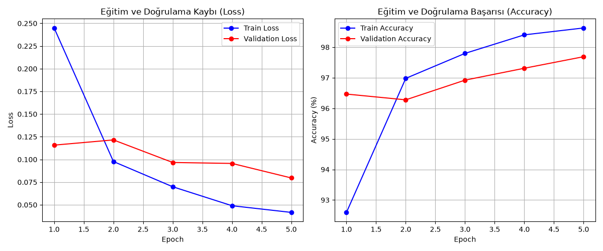

## 4. Gerçek Dünya Verisi Testi ve MLP'nin Sınırları (Hata Analizi)
Eğitim (Train) ve Test aşamalarında elde edilen yüksek doğruluk oranlarına rağmen, model dışarıdan sağlanan bazı net rakamları yanlış sınıflandırmıştır (Misclassification). 

Bu hatalar tesadüfi değildir ve doğrudan **MLP (Multi-Layer Perceptron) mimarisinin yapısal zayıflıklarından** kaynaklanmaktadır:

1. **Uzamsal Bilgi Kaybı (Lack of Spatial Locality):** 28x28 boyutundaki 2D matris ağa beslenmeden önce 784 elemanlı 1D bir vektöre dönüştürülür (Flattening). Bu işlem, pikseller arasındaki komşuluk, açı ve geometrik bütünlük bağlarını tamamen yok eder. Model artık iki boyutlu bir "şekil" değil, birbirinden bağımsız 784 farklı istatistiksel sinyal noktası görür. 
2. **Konumdan Bağımsızlık Eksikliği (No Translation Invariance):** Rakamlardaki ufak eğiklikler veya şapka çizgileri, 1D düzleştirilmiş vektörde modelin ağırlık (weight) matrisinde ezberlediği farklı rakamların piksel indislerine (index) denk gelmiştir. MLP mimarisi görüntüdeki ufak kaymaları, dönmeleri veya el yazısı farklılıklarını tolere edemez.
3. **Şablon Eşleşmesi ve Dağılım Kayması (Distribution Shift & Stroke Width):** Model, ağırlıklarını MNIST veri setindeki kalın (bold) fırça darbelerine göre optimize etmiştir. Test için kullanılan gerçek dünya verisindeki ince kalem çizgileri veya üstü kapalı kusursuz geometrik yapılar, modelin beklediği ezberlenmiş şablonlarla uyuşmamış ve "Domain Gap" (alan boşluğu) yaratmıştır.

**Sonuç:** Piksellerin uzamsal (komşuluk) özelliklerini filtrelerle (kernel) koruyan **CNN (Evrişimli Sinir Ağları)** gibi mimariler kullanılmadığı sürece, sadece MLP tabanlı modeller gerçek dünya optik karakter tanıma (OCR) problemlerinde manipülasyona ve hata yapmaya fazlasıyla açıktır.

---

## 5. Kapsamlı El Yazısı Test Seti (0-9)
Modelin gerçek dünya verisi üzerindeki algı sınırlarını tam olarak ölçmek için 0'dan 9'a kadar tüm rakamlar tek tek test edilmiştir. Aşağıdaki tabloda ham el yazısı fotoğrafları ile modelin ön işleme sonrası algıladığı matris ve tahmin sonuçları karşılaştırmalı olarak sunulmuştur.

| Rakam | Ham El Yazısı Görüntüsü | Modelin Tahmin Çıktısı (Matris) |
| :---: | :---: | :---: |
| **0** | 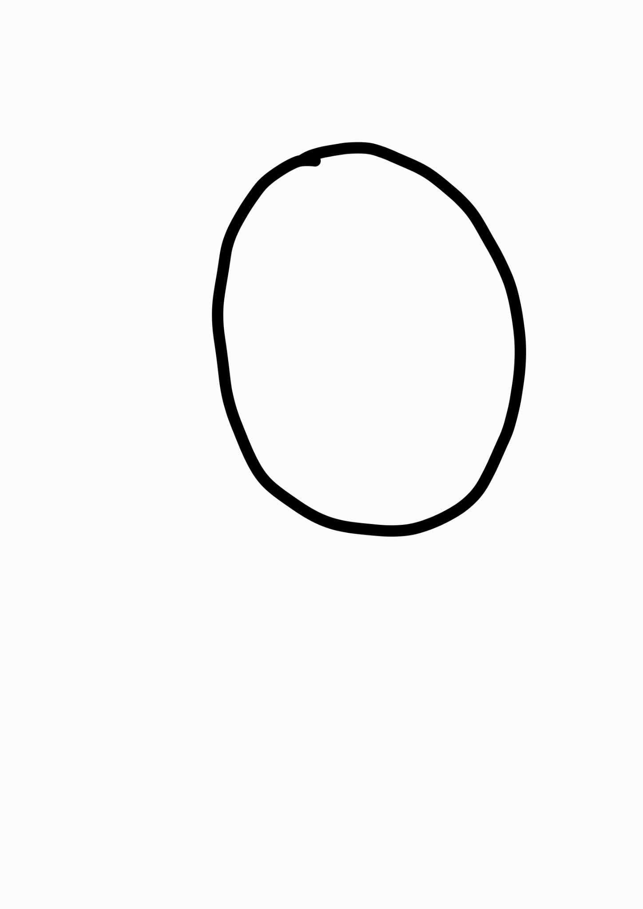 | 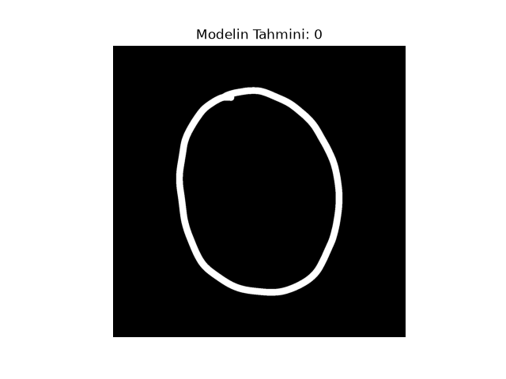 |
| **1** | 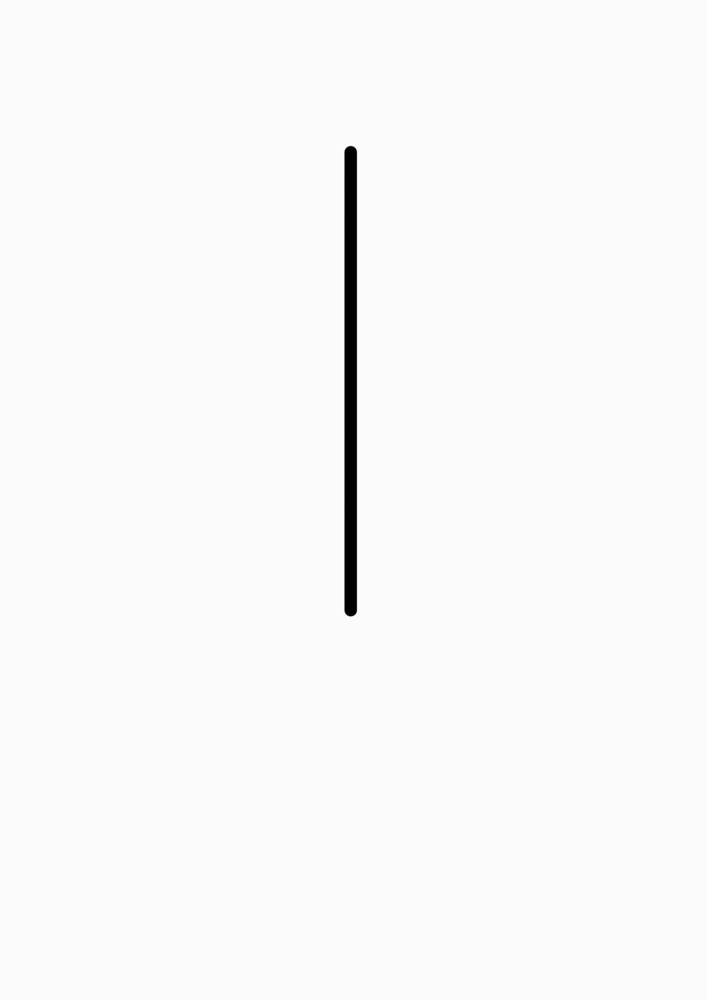 | 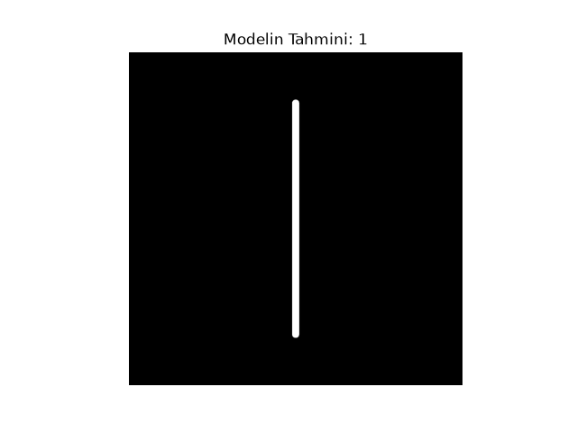 |
| **2** | 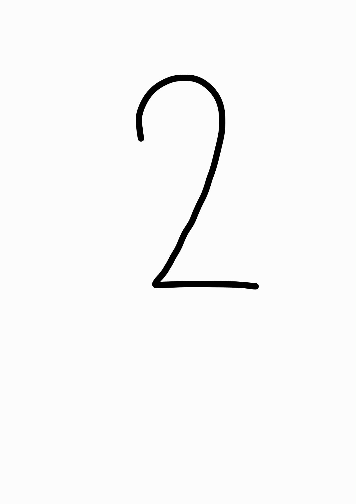 | 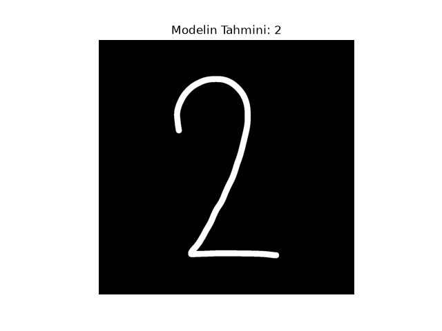 |
| **3** | 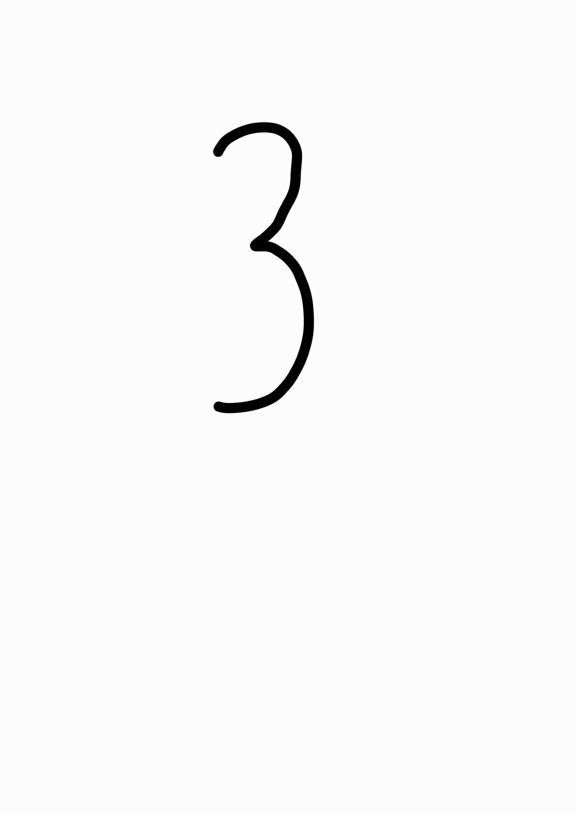 | 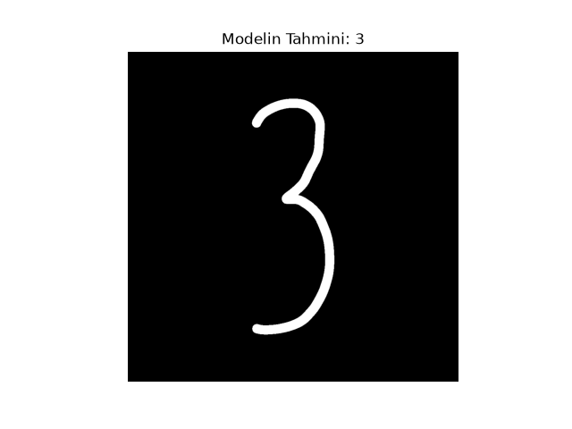 |
| **4** | 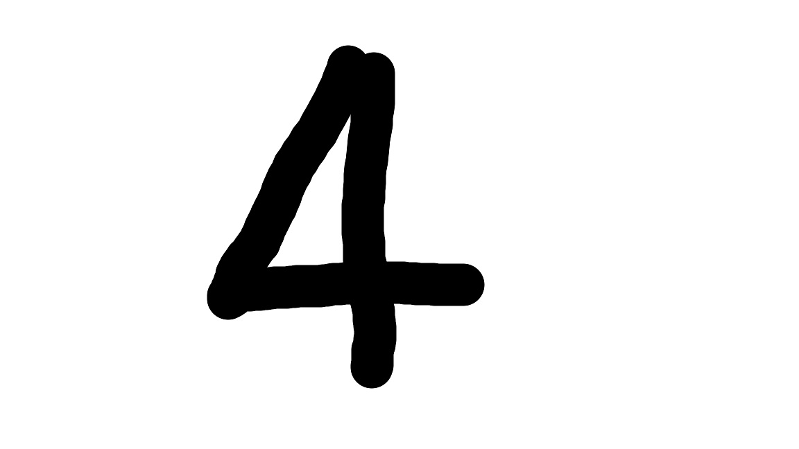 | 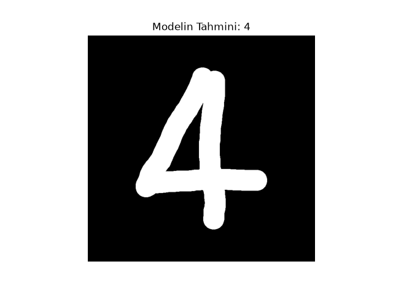 |
| **5** |  | 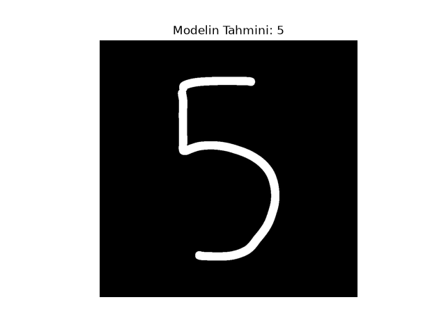 |
| **6** | 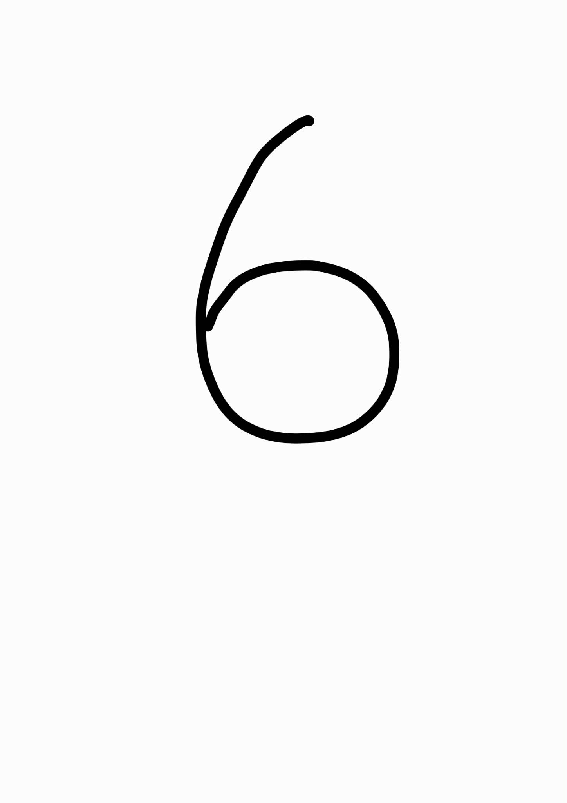 | 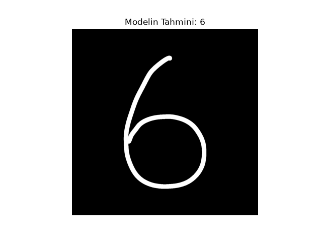 |
| **7** | 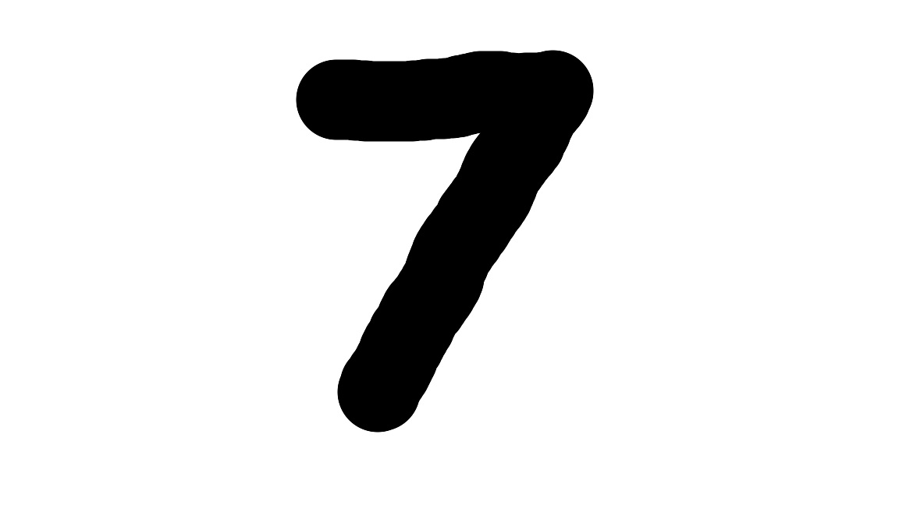 | 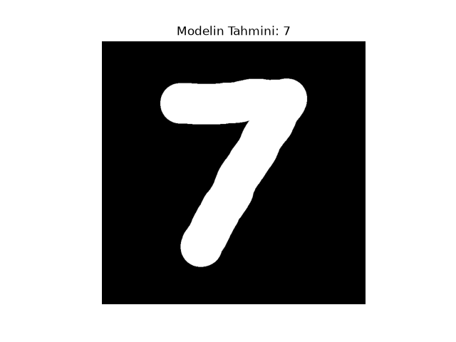 |
| **8** | 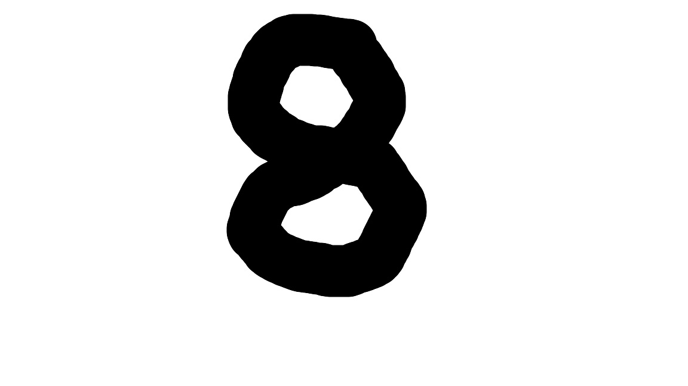 | 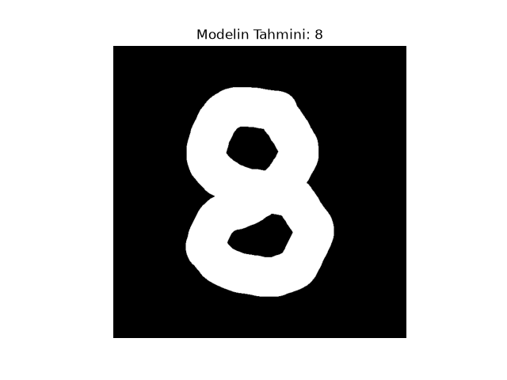 |
| **9** | 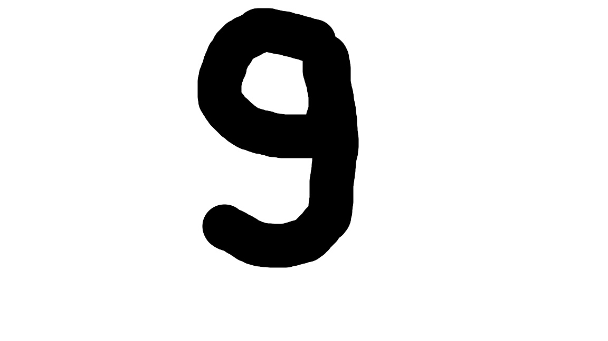 | 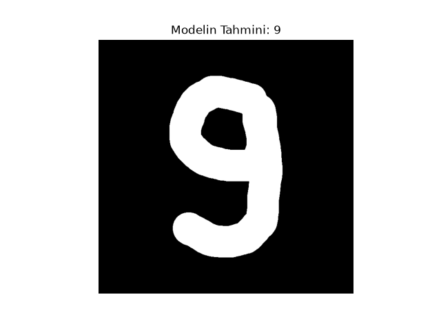 |